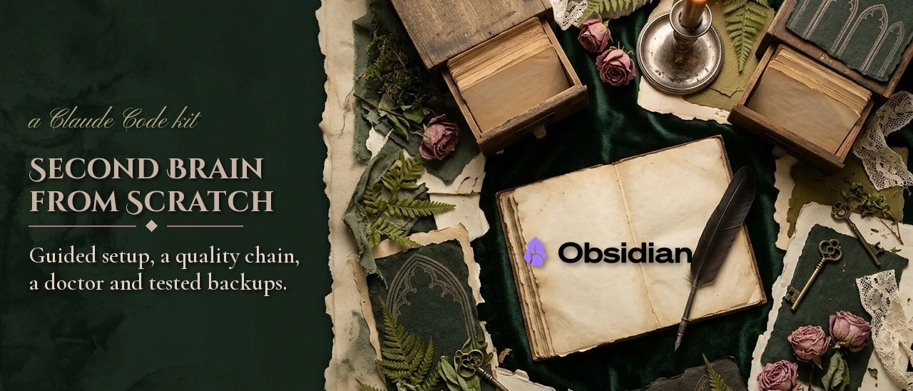
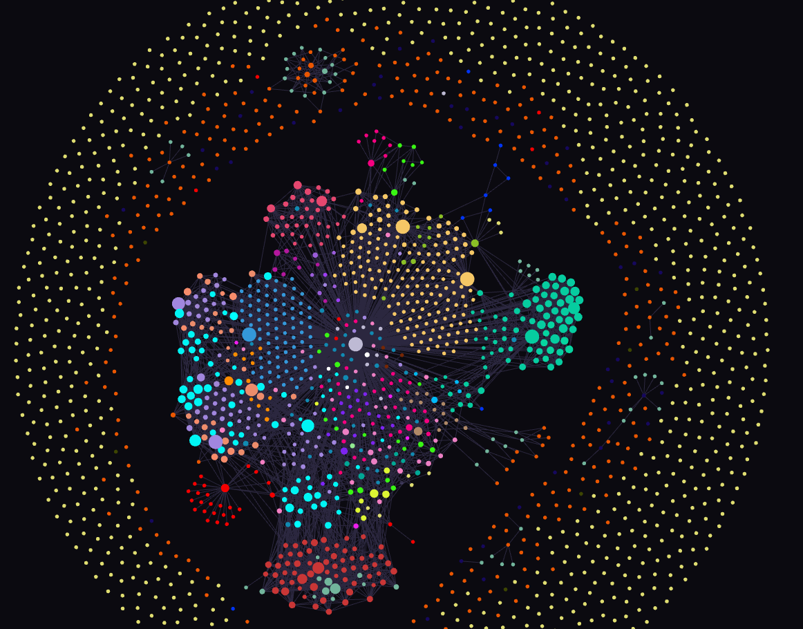

# Second Brain from Scratch



> Build your own second brain from zero: an Obsidian vault that an AI agent maintains for you, fed by your chat history, Google Drive and YouTube, checked by rules instead of trust, and backed up with a restore you have actually tested.


**Contents:** [Why](#why-this-exists) · [What you get](#what-you-get) · [What makes it different](#what-makes-it-different) · [How it works](#how-it-works) · [Quick start](#quick-start) · [The guide](#the-guide) · [Requirements](#requirements) · [Who does what](#who-does-what) · [Publishing your own version](#publishing-your-own-version) · [Tested and not tested](#tested-and-not-tested) · [Credits](#credits) · [License](#license)

## Why this exists

Most people who try a "second brain" end up with one of two things: a folder of notes they never open, or a pile of AI chat logs they cannot search. This kit takes a different route. Your notes are plain markdown files in a vault. One constitution file (`AGENTS.md`) tells any AI agent how to maintain it. Everything that comes in, from chat exports, Drive or YouTube, passes a scope decision first and a quality check after, and nothing is written to the wiki until you say yes.

**The idea behind it.** The pattern used here (raw sources you never edit, a wiki an AI agent writes and maintains, and a rules file that tells the agent how) comes from Andrej Karpathy's [LLM Wiki](https://gist.github.com/karpathy/442a6bf555914893e9891c11519de94f) idea file (April 2026). This kit is one practical, tested way to build it on Windows with Obsidian and Claude Code; it adds the import steps, the quality chain, the doctor and the backups.

It grew out of a real vault built over several weeks, and the guide keeps the mistakes that happened along the way, so you can skip them.

## What it looks like



*A beginner-level example: the author's own vault, still young, in the graph view zoomed far out (names hidden). Every color is one folder; chapter 16 shows how to set that up. Yours starts much smaller, and that is fine.*

## What you get

| Piece | What it is |
|---|---|
| `vault-template/` | an empty, ready vault: folders, `AGENTS.md`, `CLAUDE.md`, index, log, page templates, a vault-doctor skill |
| `vault-template/tools/vault_doctor.py` | a read-only health check: broken links, empty files, changed raw files, future dates, privacy fields |
| `docs/` | a 16-part guide from "download Obsidian" to "restore a backup" and "make it yours" |
| `examples/filled-vault/` | an invented, filled-in vault: decisions, a Drive folder map, one channel import with its check report, a lesson, a rule and a private note. The doctor reports 0 findings on it |
| `scripts/list_export_titles.py` | lists the conversations in a Claude or ChatGPT export, titles only |
| `scripts/youtube_list.py` | lists a YouTube channel and keeps a resume file you update with `--mark`, so finished videos are not processed twice |
| `scripts/backup-vault.ps1`, `scripts/test-restore.ps1` | dated zip backups, and a restore test that proves they work |

## What makes it different

- **Scope before import.** Every source (Claude, ChatGPT, Gemini, Drive, YouTube, NotebookLM) starts with a titles-only list, a TAKE / SKIP / LATER decision by you, and a recorded decision page. Passwords, ID papers, finance and other people's data are on the default "never" list.
- **A quality chain, not trust.** Cheap models analyse, a different tool checks, a strong model writes a short check report, you approve, and only then is anything written. The producer never approves its own work.
- **A doctor that reads raw as evidence.** `raw/` is never edited; a snapshot lets the doctor flag any raw file that was deleted or changed (by size for every file, by content hash for files up to 50 MB).
- **Labels on every claim.** `[MEASURED]`, `[SOURCED]`, `[OWNER]`, `[UNVERIFIED]`: a reader can tell a computed number from a remembered one. The labels are a convention the agent follows; the doctor only counts `[UNVERIFIED]`.
- **A restore test, not just a backup.** The kit ships the script that unzips the newest backup and runs the doctor on the copy.
- **Honest limits.** The doctor checks structure, not truth; the guide says so, and says which parts were not tested.

## How it works


| Step | What happens | Where it is explained |
|---|---|---|
| List | titles only, nothing is read yet | [03](docs/03-scope-rule.md) |
| Decide | you choose per category; the choice is saved as a decision page | [03](docs/03-scope-rule.md) |
| Analyse and check | cheap agent, then a different tool, then a strong model | [14](docs/14-quality-chain.md) |
| Approve and write | nothing reaches `wiki/` before your yes | [14](docs/14-quality-chain.md) |
| Audit and back up | the doctor reads the vault; a zip leaves the PC | [11](docs/11-updating.md), [12](docs/12-backup.md) |

## Quick start

0. Get this repo onto your PC: on the repo page click the green **Code** button, then **Download ZIP**, then right-click the zip and **Extract All**. (If you know git, `git clone` works too.)
1. Install Obsidian, Python and Claude Code (full steps with commands in [01. Setup from zero](docs/01-setup-from-zero.md)).
2. Copy `vault-template/` to your own folder (and this repo's `scripts/` folder into it), and open that folder in Obsidian.
3. In that folder run `claude` and paste the first-run message ([docs/01, step 5](docs/01-setup-from-zero.md): open PowerShell in your vault folder, run `claude`, paste it; it also takes the first snapshot of `raw/`).
4. Run the doctor and expect `ERROR 0 | WARNING 0 | INFO 0`:
```powershell
python -I -X utf8 tools/vault_doctor.py
```
5. Import your sources one at a time, in the order of the guide below.
6. Make it yours: pick a theme and color the graph by folder ([chapter 16](docs/16-make-it-yours.md)).

## The guide

| # | Page | What it covers |
|---|---|---|
| 01 | [Setup from zero](docs/01-setup-from-zero.md) | Obsidian, Python, Claude Code, your first vault, first run |
| 02 | [Vault structure](docs/02-vault-structure.md) | folders, raw versus wiki, naming, frontmatter, links |
| 03 | [Scope rule](docs/03-scope-rule.md) | what comes in, what stays out, decision pages |
| 04 | [Claude history](docs/04-claude-history.md) | export, list, decide, import |
| 05 | [ChatGPT history](docs/05-chatgpt-history.md) | same, plus the shared-account warning |
| 06 | [Gemini history](docs/06-gemini-history.md) | Google Takeout, gems |
| 07 | [Google Drive](docs/07-google-drive.md) | map first, open later; what never comes in |
| 08 | [YouTube data](docs/08-youtube-data.md) | list, select, transcripts, summaries, resume file |
| 09 | [NotebookLM notebooks](docs/09-notebooklm-notebooks.md) | bringing existing notebooks in |
| 10 | [Privacy](docs/10-privacy.md) | three levels, what never goes in |
| 11 | [Updating](docs/11-updating.md) | new videos, new exports, changing a rule, weekly lint |
| 12 | [Backup and restore](docs/12-backup.md) | script, schedule, restore test |
| 13 | [Lessons and pitfalls](docs/13-lessons-and-pitfalls.md) | what went wrong and the rule it became |
| 14 | [Quality chain](docs/14-quality-chain.md) | cheap agents analyse, others check, a script audits |
| 15 | [Optional tools](docs/15-optional-tools.md) | graph tool, speech to text, second agent, scheduled tasks |
| 16 | [Make it yours](docs/16-make-it-yours.md) | pick an Obsidian theme, color the graph by folder, optional folder colors |

## Requirements

| Item | Needed for | Notes |
|---|---|---|
| Windows 10 or 11 with PowerShell | everything | Mac and Linux: see "Tested and not tested" |
| [Obsidian](https://obsidian.md/download) | reading and editing the vault | free download from the official site |
| [Python](https://www.python.org/downloads/) 3.8+ (only 3.14 was tested) | the doctor and the scripts | standard library only, except `yt-dlp` and the NotebookLM tool; that tool needs Python 3.11 or newer |
| [Claude Code](https://code.claude.com/docs/en/setup) | the agent | needs a paid Claude plan or a Console account |
| [Git for Windows](https://git-scm.com/downloads/win) | only if you want `git clone` or your own GitHub copy | optional; "Download ZIP" works without it |
| [`yt-dlp`](https://github.com/yt-dlp/yt-dlp) | YouTube listing (chapter 08) | `pip install yt-dlp` |
| [NotebookLM](https://notebook.google.com) and its command-line tool [`notebooklm-mcp-cli`](https://pypi.org/project/notebooklm-mcp-cli/) | transcripts and summaries (chapters 08, 09) | optional; `pip install notebooklm-mcp-cli`, then `nlm login` (you sign in yourself). It uses undocumented Google interfaces: personal use, at your own risk |
| [Google Takeout](https://takeout.google.com) | the Gemini history (chapter 06) | a Google account; nothing to install |
| A cloud-synced folder | backups that leave your PC | [Google Drive for desktop](https://workspace.google.com/products/drive/), OneDrive or Dropbox |

If a tool is missing, the guide tells you what to install and asks you to do the sign-in yourself.

## Who does what

| You | The agent |
|---|---|
| install the tools, sign in, pay | reads `AGENTS.md`, `INDEX.md`, the log |
| decide TAKE / SKIP / LATER | proposes categories, titles only |
| approve before anything is written | writes pages, index and log lines |
| read the doctor report | runs the doctor and summarises it |
| keep passwords and recovery codes out of the vault | never imports them |

## Publishing your own version

Do not publish your vault. If you build a public template from your own work:
1. Start from a clean copy, not from your vault.
2. Remove names, employers, paths, e-mail addresses and anything private.
3. Scan mechanically (a script, not a reading): look for your name, your username, drive letters, e-mail patterns, keys and tokens.
4. Make the repo **private** first, read every file yourself, and only then decide to make it public.

## Tested and not tested

Tested on Windows 11 with PowerShell 5.1 and Python 3.14:
- the doctor on a clean vault (0 findings) and on a vault with deliberately injected faults (broken link, empty file, deleted and changed raw file, future date, BOM, stray root file, missing privacy field, missing frontmatter, missing decision fields): all detected;
- `backup-vault.ps1` and `test-restore.ps1` (backup, restore, doctor on the restored copy, error log on a missing source);
- `list_export_titles.py` on synthetic Claude and ChatGPT export files (real exports not available to the kit author at test time);
- `youtube_list.py` on a public channel (tested by the author on a public channel with network access; the offline parts were re-run independently): listing, the resume file not being overwritten, `--mark` with a valid and an invalid status, and the incomplete list.

Known limit: newer ChatGPT exports may split chats into several `conversations-*.json` files; `list_export_titles.py` only reads `conversations.json`.

Used by the author in a real working vault on Windows (November 2026), not re-run step by step for this kit:
- importing the Claude, ChatGPT and Gemini (Google Takeout) histories and a Google Drive folder, with the menu steps described in the guide;
- the NotebookLM command-line steps for YouTube transcripts and summaries;
- a daily scheduled backup with `schtasks`;
- the folder colors in the graph view.

These are real, but the apps change their menus often, so check each step against what you see on screen.

Not tried at all, so treat as unverified:
- Mac and Linux (the vault files and Python scripts are system independent; the install commands and the backup scripts are Windows only).
- The optional CSS snippets in the theme chapter.

## Added by this kit, not yet proven over time

The core rules (approval gate, raw is never edited, producer is not checker, scope before import, the doctor checks, the YouTube selection rule, daily backups) come from a vault that has been used in practice. These parts are new in this kit and have only been tested as described above, not lived with:
- the restore-test script and the monthly restore habit,
- the `LATER` option in the scope decision,
- the "scripts check scripts" rule and the six-step chain written as one process,
- the rules for scheduled tasks,
- the `--mark` option of the YouTube script and its `incomplete.txt`, `new_videos.txt` and `unavailable` status,
- the English port of the vault doctor (it has more checks than the original and was only run on the template and the example vault, never on the author's own vault),
- the `-KeepDays` and `-LogFile` options of the backup script, and the quoting advice for paths with spaces (the default run with `-KeepDays 30` was tested),
- the theme and folder-color chapter and the optional-tools chapter.

## Credits

- The raw / wiki / agent pattern and the ingest / lint / index / log workflow idea come from Andrej Karpathy's [LLM Wiki](https://gist.github.com/karpathy/442a6bf555914893e9891c11519de94f) (a public gist, April 2026). This kit contains none of its text, only the idea, explained in my own words. It is not written, reviewed or endorsed by Andrej Karpathy.
- Install commands come from the official Claude Code setup page.
- Written by the kit's author from a real working vault.
- The banner art was made with Google Flow; the typography and layout belong to the author. The Obsidian logo on the notebook is the official purple lockup, used unaltered (only scaled) as published on Obsidian's brand page.
- All product names (Obsidian, Claude, ChatGPT, Gemini, Google Drive, YouTube, NotebookLM and others) are trademarks of their respective owners. This kit is an independent, non-commercial project. It is not affiliated with, sponsored by or endorsed by Obsidian or Anthropic.

## License

MIT. See [LICENSE](LICENSE).
