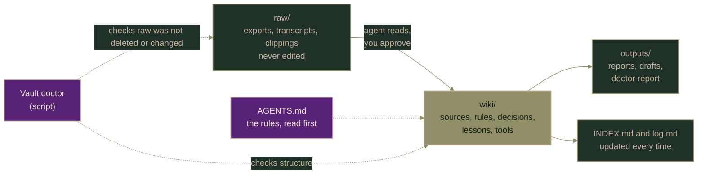

# 02. Vault structure

```
MyVault/
  AGENTS.md          the constitution: every rule, read at the start of every session
  CLAUDE.md          short entry point that sends Claude Code to AGENTS.md
  raw/               INBOX: exports, transcripts, clippings. Never edited by the agent
    exports/ transcripts/ clippings/ srt/ analytics/ notes/
  wiki/              COMPILED knowledge. Only the agent writes here
    INDEX.md         catalog of every page
    log.md           append-only log, one line per operation
    sources/ rules/ decisions/ lessons/ formulas/ tools/ syntheses/ channels/ competitors/
  outputs/           things you will copy and use (reports, drafts, doctor report)
  conversations/     one folder per imported chat that is off your main topic
  tools/             small check scripts (vault_doctor.py)
  skills/            written methods the agent reads before a job (Skill-list.md)
  templates/         page templates with frontmatter
```
The folders `channels/` and `competitors/` are examples from a YouTube-research vault. Rename or delete the ones you do not need; just keep `INDEX.md` honest.

How the parts relate:



## Why it is built this way

**Raw and wiki are separate.** `raw/` holds what came in, untouched, so you can always go back to the source and prove where a fact came from. `wiki/` holds what was understood. If an agent damages a wiki page, you rebuild it from raw. If it could damage raw, you lose the evidence. After you take a snapshot (`python -I -X utf8 tools/vault_doctor.py --snapshot`), the doctor reports an ERROR if anything in `raw/` is deleted or changed: by size for every file, and also by content (a sha256 hash) for files up to 50 MB. Files added to `raw/` after the snapshot are not flagged (new imports are normal), so take a new snapshot after you deliberately add raw files.

**One constitution file.** `AGENTS.md` holds all rules. `CLAUDE.md` only points to it. Other agents (Codex, Gemini CLI) read `AGENTS.md` too, so the rules are the same whoever works in the vault. Keep it under 200 lines: a long rule file is not read carefully. Move detail into `wiki/rules/`.

**An index and a log, always.** After every operation the agent updates `wiki/INDEX.md` and appends one line to `wiki/log.md`. The index lets it find things without opening everything. The log lets you (and the next session) see what happened and when.

**Labels on claims.** `[MEASURED]`, `[SOURCED]`, `[OWNER]`, `[UNVERIFIED]` (see `AGENTS.md`). The point is that a reader can tell a computed number from a remembered one.

## Page naming
- Meaningful names, no numbers, no dates in the file name (`engagement-rules.md`, not `01-rules-2026-03-04.md`). The date goes in the frontmatter. A graph node is named after the file, so numbered names become unreadable graphs.
- The same name in two folders confuses links. The doctor reports it as INFO.

## Frontmatter
Every wiki page starts with:
```yaml
---
type: source        # source | rule | decision | lesson | formula | tool | synthesis
updated: 2026-01-31
privacy: open       # optional: open | internal | private
---
```
Templates for each type are in `templates/`.

## Links
Use `[[page-name]]`. Obsidian then shows backlinks and a graph. The doctor reports broken links and orphan pages so the graph stays connected.

## Graph colors (optional)
Obsidian can color graph nodes by folder (Settings, Graph view, Groups). When you add a new folder that will hold notes, add a group for it. This setting is stored in `.obsidian/graph.json`; edit it only while Obsidian is closed, and copy the file first.

## Hex colors in notes
Write hex codes in code format, for example `#00FF41` with backticks. A bare `#00FF41` is read as a tag and creates an empty tag node.
