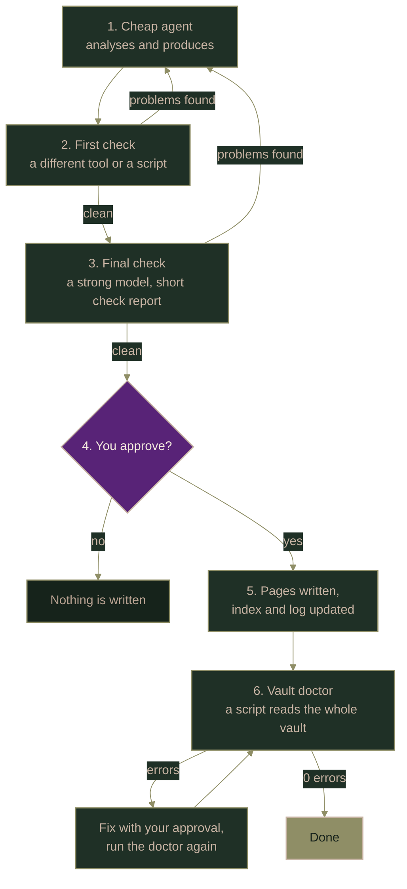

# 14. The quality chain: cheap agents analyse, others check, a script audits

Cheap models are fast and cost little, and they invent things, skip things and miscount. The answer is not to avoid them. It is to make sure **nothing a cheap model produced is accepted unchecked**, and that **whoever produced a result never approves it**.

## The six steps

| Step | Who | What they do |
|---|---|---|
| 1. Analyse and produce | cheap agent (a small model, or a free-tier model) | scan, summarise, extract rules, file things. Never rewrites verbatim transcripts |
| 2. First check | a mid-level agent **from a different tool**, or a script | looks every number and name up in the source, flags doubtful lines. Different tool than the producer |
| 3. Final check | a strong model | reads the first check's short report, re-checks at most two examples itself, writes a short check report |
| 4. Approval gate | you | see the list and the check report. Nothing is written to `wiki/` until you say yes |
| 5. Write | the agent | writes pages, updates the index and the log |
| 6. Vault doctor | a script, not an AI | scans the whole vault for structural problems. Read its report before saying "clean" |

## Rules that make it work
1. **Producer is not checker.** The tool that wrote it never approves it. Use a different model or a script.
2. **A check report is produced and shown to you**: how many lines examined, how many fixed, dropped or merged, what is still doubtful.
3. **Unchecked output is labelled "not checked".** It does not get a checkmark.
4. **Mid-level work is checked too.** Merging and design done by the mid-level agent goes through an independent checker as well.
5. **Count with code.** If a check is countable (title lengths, word counts, matching ratios), a script does it; an agent only reads the script's output.
6. **Agents do not make up rules.** For any task that has written rules, the brief names the rule file by path, the agent reports each change with the rule it applied, and if no rule exists it stops and asks. Your own titles, hooks or copy are never rewritten by an agent; it may only suggest. A check finding never overrides your decision: it is reported to you.
7. **Scripts check scripts.** A check script that cannot find a rule's counterpart in code reports "this rule is not measured".

## What the vault doctor adds and what it does not
It catches broken links, empty files, changed raw files, future dates, missing privacy fields and similar structural damage. It does **not** know whether a sentence is true. That is steps 2 and 3. Say this plainly in your own rules so nobody reads "doctor: 0 errors" as "all facts are correct".

## A worked example
1. A cheap model reads 80 transcripts and produces 80 summaries and 300 candidate rules.
2. A script greps every number and name from the summaries in the transcripts. It marks 14 that do not appear.
3. A different mid-level agent re-reads the 14 and about 30 random rules against the transcripts, and reports 9 fixes.
4. The strong model reads that report, re-checks two examples, and writes the check report: "examined 380 lines, fixed 9, dropped 5, doubtful 3".
5. You get the list plus the report and say "write it".
6. The pages are written; the doctor runs; you read: 0 errors, 2 warnings (missing frontmatter on two pages), fixed with approval.

(The numbers in this example are illustrative, not measurements.)

## Cost, in one sentence
Cheap models do the bulk work, a script and a mid-level agent catch most errors, and the strong model only reads reports and spot-checks, so its usage stays small.
