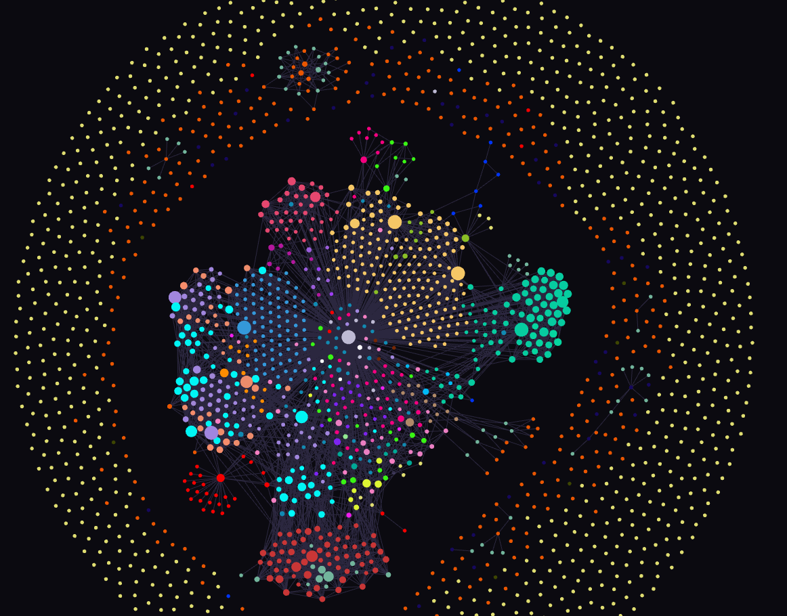

# 16. Make it yours: theme and folder colors

The fun part. The vault works without this chapter, but a second brain you enjoy opening is one you will actually use. Nothing here touches your notes: it only changes how Obsidian looks.

## 1. Pick a theme
1. Open Obsidian, then **Settings** (the cog at the bottom left).
2. Go to **Appearance**.
3. Under **Themes**, select **Manage**.
4. Browse the community themes, click one, then select **Install and use**. It applies at once.
5. To go back to the default, select **Stop using this theme**. To try another, repeat step 4.

In **Appearance** you can also choose light or dark mode and an accent color, and the font. ([UNVERIFIED] the exact labels of these three options: they were not on the help page that was checked, so look in the same Appearance screen.)

Tips:
- Try three or four themes for a day each. Dark or light matters less than being able to read a long page comfortably.
- A theme only changes looks. If something breaks after a theme update, switch back with **Stop using this theme**.

## 2. Color the graph by folder


The graph view shows your notes as dots and links as lines. Groups let you color the dots by folder, so each part of your brain has its own color.

1. Open the **Graph view** (the graph icon on the left bar, or the command palette).
2. Click the **cog** in the upper right corner of the graph. The **Groups** section is there.
3. Click **New group**.
4. In the search box type a query that matches the notes. For a folder use `path:wiki/sources` (search operators are described on Obsidian's Search help page).
5. Click the **colored circle** and choose the color.
6. Repeat for each folder.

Suggested starting groups for this vault:

| Query | Meaning | Pick a color that feels like |
|---|---|---|
| `path:wiki/sources` | what you learned from | calm, cool |
| `path:wiki/rules` | rules | strong, clear |
| `path:wiki/decisions` | your decisions | warm |
| `path:wiki/lessons` | lessons | soft accent |
| `path:wiki/tools` | tool notes | neutral |
| `path:conversations` | imported chats | muted |

Groups are saved by Obsidian in the vault's `.obsidian` folder, so they survive restarts. Because that folder is part of the vault, the daily backup includes your colors.

**When you add a new folder that will hold notes, add a group for it.** A folder without a group appears in the default color and gets lost in the graph. Make it a habit, like updating the index.

If the graph view looks cluttered, use the filter section of the same cog menu (for example hide orphan notes), or set a group for each part you care about and let the rest stay gray.

## 3. Optional: colored folders in the sidebar (CSS snippet)
Obsidian can load small style files called **CSS snippets** from a folder inside the vault, `.obsidian/snippets`. Enable them in **Settings, Appearance, CSS snippets** (the reload button next to it appears after you add a file). This is a more advanced step and **was not tested in this kit**, so treat the example as a starting point.

Example file `.obsidian/snippets/folder-colors.css`:
```css
/* color the folder names in the file explorer */
.nav-folder-title[data-path="wiki/sources"] { color: #6fa8a0; }
.nav-folder-title[data-path="wiki/rules"] { color: #c98b8b; }
.nav-folder-title[data-path="wiki/decisions"] { color: #d4a35f; }
```
Write the real colors you like. If the colors do not show, check that the snippet is switched on and that the folder path in `data-path` matches exactly. If it breaks the look, switch the snippet off.

## 4. Pick a palette that holds together
- Choose 3 to 5 colors and reuse them for the graph, the folder names and your notes' accents.
- Keep enough contrast between text and background so long pages stay readable.
- If you keep a note of your palette, write hex codes in code format with backticks, for example `#6fa8a0`. A bare hex code is read as a tag and creates an empty tag node (see [13](13-lessons-and-pitfalls.md), lesson 4).

## 5. Ask the agent, but you choose
You may ask the agent to write the CSS snippet or list the groups to add. **You** choose the colors and the theme. Colors in `.obsidian/graph.json` are best changed through the graph's settings while Obsidian is open. If you ever edit that file by hand, close Obsidian first and make a copy of the file.
